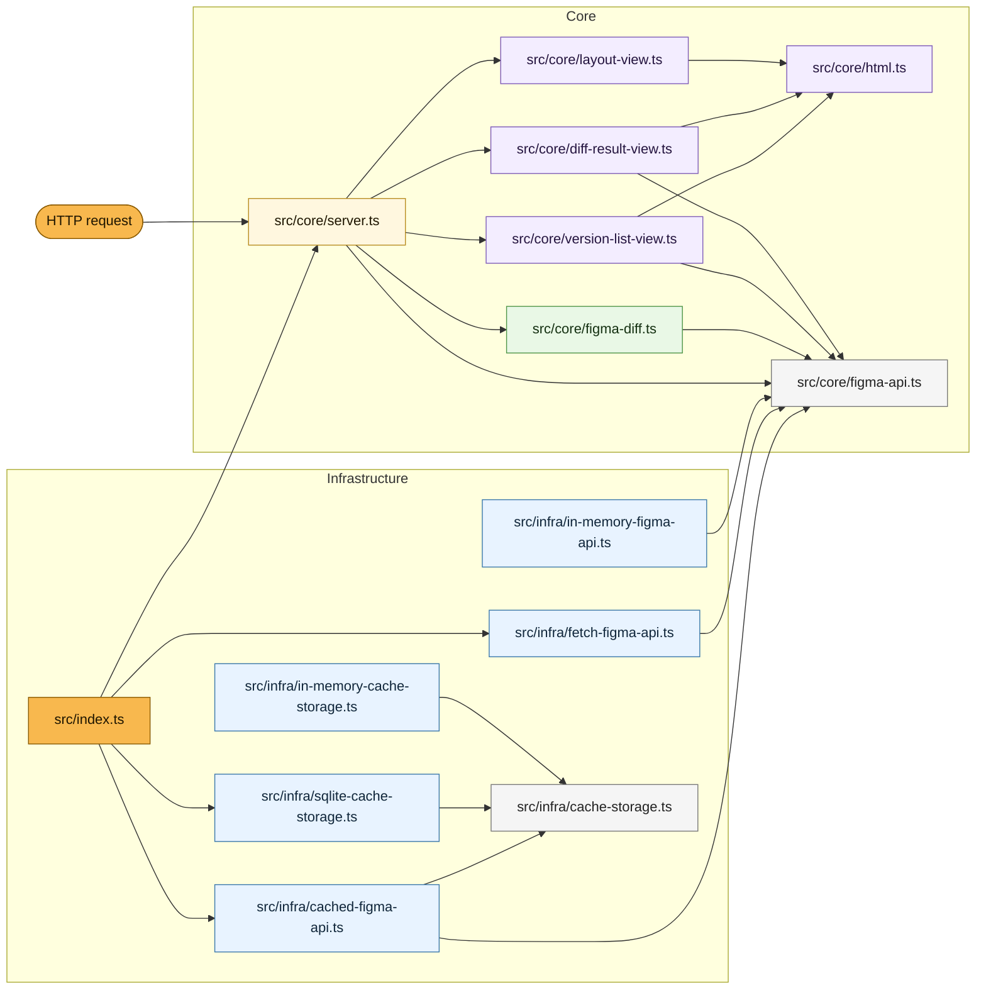

# figma-diff

Small Bun app buat compare current Figma file dengan version tertentu.

## Setup

```bash
bun install
cp .env.example .env
```

Isi `.env`:

```bash
FIGMA_ACCESS_TOKEN=figd_your_token_here
FIGMA_FILE_KEY=AbCdEfGhIjKlMnOpQrStUv
FIGMA_FILE_NAME=Example-Figma-File
PORT=3000
```

## Run

```bash
bun run server
```

Buka:

```text
http://localhost:3000
```

Default server pakai Figma API live + SQLite cache di `figma-cache.sqlite`.

## Agent / LLM Usage

Kalau dipakai agent buat jawab "Figma ada perubahan apa aja?", jangan scrape HTML. Pakai endpoint JSON.

Start server di port eksplisit:

```bash
PORT=3434 bun src/index.ts
```

Ambil daftar version:

```bash
curl -sS "http://localhost:3434/versions.json"
```

Compare selected version dengan current file:

```bash
curl -sS "http://localhost:3434/diff.json?version=<version-id>"
```

Compare dua historical versions:

```bash
curl -sS "http://localhost:3434/diff.json?before=<version-id>&after=<version-id>"
```

Lihat perubahan bertahap sejak version tertentu:

```bash
curl -sS "http://localhost:3434/changes-since.json?version=<version-id>"
```

Endpoint JSON penting:

- `/versions.json` -> daftar version + `diffUrl` / `changesSinceUrl`.
- `/diff.json?version=<version-id>` -> summary, changed pages, changed frames, field-level changes, dan Figma links.
- `/changes-since.json?version=<version-id>` -> grouped timeline perubahan per top-level node.

Cara baca output:

- Mulai dari `summary.counts` atau `summary.totals`.
- Lanjut ke `changedPages[].frames[]` atau `topLevelNodes[].steps[]`.
- Pakai `changes[].summary` buat kalimat perubahan field-level.
- Pakai `figmaUrl`, `beforeFigmaUrl`, atau `afterFigmaUrl` buat link inspect.
- Selalu cek `warnings`. Kalau ada stale-cache warning, hasilnya cache-derived dan belum boleh disebut latest tanpa refresh cache/API.

Untuk hemat Figma API, server default pakai SQLite cache. Jangan clear cache kecuali memang perlu refresh.

Lihat juga [`llms.txt`](./llms.txt) untuk instruksi ringkas khusus agent.

## Test

```bash
bun test
```

Typecheck:

```bash
bunx tsc --noEmit
```

## Screenshot Views

```bash
bun run view-test
```

Output disimpan ke `screenshots/`.

## Behavior

- Version list membuka `/diff?version=<version-id>`.
- Diff membandingkan selected version sebagai `before` dengan current Figma file sebagai `after`.
- Diff routes fetch file pakai `depth=3`.
- JSON diff routes fetch file pakai `depth=3`.
- Cache key file response pakai `depth` dari request options.
- Link Figma untuk `before` pakai `version-id`.
- Link Figma untuk `after` / current tidak pakai `version-id`.

## Architecture


